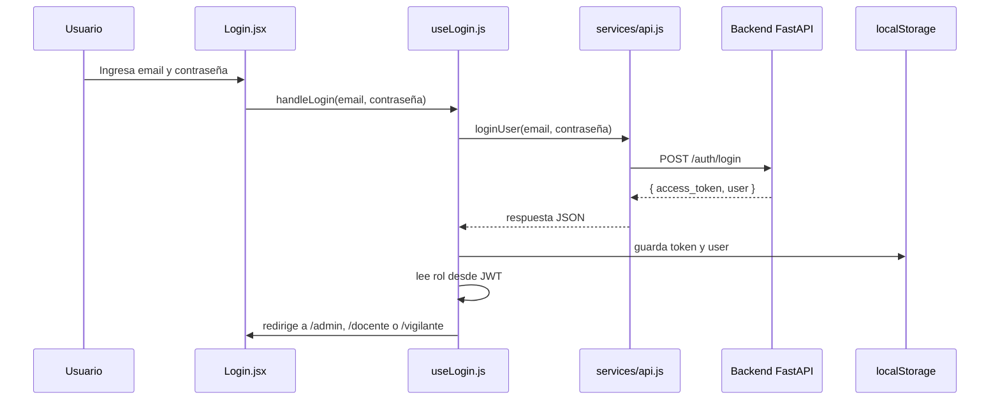

# KronosGate Frontend

Aplicación web construida con React + Vite para la interfaz de un sistema escolar de asistencia y control de tardanzas. La capa frontend es la interfaz que usan los usuarios para autenticarse, navegar según su rol, consultar información escolar y enviar solicitudes al backend.

## 1. Propósito del proyecto

KronosGate Frontend permite a los distintos perfiles del sistema:

- iniciar sesión con correo y contraseña;
- navegar según el rol asignado (`admin`, `docente`, `vigilante`);
- consultar estudiantes, grados, usuarios, registros y reportes;
- registrar asistencias y tardanzas desde la vista de vigilante;
- proteger rutas para que solo usuarios autorizados accedan a cada panel.

La responsabilidad principal del frontend es la experiencia de usuario y la presentación de datos. La lógica crítica de permisos, validación y persistencia se ejecuta en el backend.

## 2. Tecnologías y dependencias reales

La configuración actual del frontend se encuentra en `package.json` y `vite.config.js`.

| Tecnología | Propósito real en el proyecto |
| --- | --- |
| React 18 | Construcción de la interfaz de usuario | 
| React DOM | Montaje de la app en el navegador |
| React Router DOM | Navegación y enrutamiento por rutas |
| Vite | Servidor de desarrollo y compilación |
| Tailwind CSS | Estilos utilitarios y diseño visual |
| PostCSS | Procesamiento de CSS para Tailwind |
| Fetch API | Solicitudes HTTP al backend |
| localStorage | Persistencia del token JWT y del usuario |
| JWT (solo lectura del payload) | Verificación local de expiración y rol |

Dependencias reales del proyecto:

```json
"dependencies": {
  "react": "^18.2.0",
  "react-dom": "^18.2.0",
  "react-router-dom": "^6.20.0"
},
"devDependencies": {
  "@vitejs/plugin-react": "^4.2.0",
  "autoprefixer": "^10.4.16",
  "postcss": "^8.4.32",
  "tailwindcss": "^3.4.1",
  "vite": "^5.0.0"
}
```

Estas dependencias son las que realmente están instaladas y se usan en el código actual.

## 3. Estructura real del frontend

```text
Media-Tecnica-Frontend/
├── index.html
├── package.json
├── vite.config.js
├── tailwind.config.js
├── postcss.config.js
├── .env.example
├── src/
│   ├── App.jsx
│   ├── main.jsx
│   ├── index.css
│   ├── EXAMPLES_ROLE_PROTECTION.js
│   ├── components/
│   │   ├── AdminTable.jsx
│   │   ├── ConfirmModal.jsx
│   │   ├── FilterPanel.jsx
│   │   ├── FormModal.jsx
│   │   ├── SkeletonLoader.jsx
│   │   ├── StatCard.jsx
│   │   └── layout/
│   │       ├── AdminLayout.jsx
│   │       ├── AdminNavbar.jsx
│   │       ├── AdminSidebar.jsx
│   │       ├── DocenteLayout.jsx
│   │       ├── DocenteSidebar.jsx
│   │       ├── Navbar.jsx
│   │       ├── Sidebar.jsx
│   │       ├── VigilanteLayout.jsx
│   │       └── VigilanteSidebar.jsx
│   ├── context/
│   │   └── AuthContext.jsx
│   ├── hooks/
│   │   ├── useApiCall.js
│   │   ├── useCache.js
│   │   ├── useDebounce.js
│   │   ├── useErrorHandler.js
│   │   ├── useExportCSV.js
│   │   ├── useFilters.js
│   │   ├── useForm.js
│   │   ├── useLogin.js
│   │   └── usePagination.js
│   ├── pages/
│   │   ├── AdminDashboard.jsx
│   │   ├── AdminPanel.jsx
│   │   ├── UnauthorizedPage.jsx
│   │   ├── admin/
│   │   │   ├── Configuracion.jsx
│   │   │   ├── Estudiantes.jsx
│   │   │   ├── Grados.jsx
│   │   │   ├── Registros.jsx
│   │   │   ├── Roles.jsx
│   │   │   └── Usuarios.jsx
│   │   ├── auth/
│   │   │   └── Login.jsx
│   │   ├── docente/
│   │   │   ├── DocenteDashboard.jsx
│   │   │   ├── DocentePanel.jsx
│   │   │   ├── Registros.jsx
│   │   │   └── Reportes.jsx
│   │   └── vigilante/
│   │       ├── RegistrarIngreso.jsx
│   │       ├── VigilanteDashboard.jsx
│   │       └── VigilantePanel.jsx
│   ├── routes/
│   │   └── Protectedrute.jsx
│   ├── services/
│   │   ├── api.js
│   │   ├── configuracionService.js
│   │   ├── estudiantesService.js
│   │   ├── gradosService.js
│   │   ├── registrosService.js
│   │   ├── rolesService.js
│   │   └── usuariosService.js
│   ├── utils/
│   │   ├── jwt.js
│   │   ├── testJWT.js
│   │   ├── toast.jsx
│   │   └── validators.js
│   └── context/
│       └── AuthContext.jsx
```

### Carpetas importantes

- `src/App.jsx`: define rutas y contexto global de la aplicación.
- `src/context/AuthContext.jsx`: almacena el token, el usuario y el rol.
- `src/hooks/`: lógica reusable: login, filtros, paginación, caché, formularios.
- `src/pages/`: vistas principales según rol.
- `src/services/`: funciones que consumen la API REST.
- `src/routes/Protectedrute.jsx`: valida autenticación y roles antes de renderizar una ruta.
- `src/utils/jwt.js`: lee el JWT del navegador para validar expiración y obtener rol.

## 4. Punto de entrada de la aplicación

`src/main.jsx` ejecuta la app y monta React en `#root`:

```jsx
ReactDOM.createRoot(document.getElementById('root')).render(
  <React.StrictMode>
    <App />
  </React.StrictMode>,
)
```

`src/App.jsx` es el centro de navegación. Allí se define el árbol de rutas:

- `/login`: acceso público
- `/access-denied`: página de acceso denegado
- `/admin/*`: rutas protegidas para admins
- `/docente/*`: rutas protegidas para docentes
- `/vigilante/*`: rutas protegidas para vigilantes

```jsx
<AuthProvider>
  <BrowserRouter>
    <ToastContainer />
    <Routes>
      <Route path="/login" element={<Login />} />
      <Route path="/admin/*" element={<ProtectedRoute requiredRole="admin" ... />} />
      <Route path="/docente/*" element={<ProtectedRoute requiredRole="docente" ... />} />
      <Route path="/vigilante/*" element={<ProtectedRoute requiredRole="vigilante" ... />} />
    </Routes>
  </BrowserRouter>
</AuthProvider>
```

## 5. Autenticación en el frontend

La autenticación se gestiona con `AuthContext` y el hook `useLogin`.

### `src/context/AuthContext.jsx`

Este archivo mantiene el estado global:

- `user`
- `token`
- `userRole`
- `loading`

También valida si el token está expirado al cargar la aplicación y hace logout automático.

```js
const storedToken = localStorage.getItem("token");
const storedUser = localStorage.getItem("user");

if (isTokenExpired(storedToken)) {
  logout();
}
```

### `src/hooks/useLogin.js`

Este hook hace el login y redirige según el rol del usuario.

```js
const response = await loginUser(email, contraseña);
setAuthToken(response.access_token, response.user);

const rol = getRoleFromToken(response.access_token) || response.user.rol;
const redirectPath = pathMap[rol] || "/";
navigate(redirectPath);
```

La lógica de redirección actual es:

- `admin` → `/admin`
- `docente` → `/docente`
- `vigilante` → `/vigilante`

## 6. Protección de rutas

El componente `src/routes/Protectedrute.jsx` verifica tres condiciones antes de permitir acceso:

1. existe un usuario autenticado;
2. el token no está expirado;
3. el rol del usuario coincide con el requerido.

```jsx
if (!isAuthenticated || !token) {
  return <Navigate to="/login" replace />;
}

if (isTokenExpired(token)) {
  return <Navigate to="/login" replace />;
}

if (!allowedRoles.includes(userRole)) {
  return <Navigate to={showAccessDenied ? "/access-denied" : "/login"} replace />;
}
```

Esto se usa para proteger paneles y páginas según cada tipo de usuario.

## 7. Comunicación con el backend

La base URL del backend está centralizada en `src/services/api.js`:

```js
const API_BASE_URL = import.meta.env.VITE_API_BASE_URL || "http://localhost:8000";
```

### `loginUser`

```js
const response = await fetch(`${API_BASE_URL}/auth/login`, {
  method: "POST",
  headers: { "Content-Type": "application/json" },
  body: JSON.stringify({ email, contraseña }),
});
```

### `getAuthHeaders`

Agrega el token al header `Authorization`:

```js
return {
  "Content-Type": "application/json",
  Authorization: `Bearer ${token}`,
};
```

### `apiCall`

Todas las llamadas autenticadas pasan por esta función para enviar el JWT y convertir errores HTTP en objetos `Error` con estado y detalle.

```js
const response = await fetch(`${API_BASE_URL}${endpoint}`, {
  headers: getAuthHeaders(),
  ...options,
});
```

Si el backend responde con `401`, `403`, `404` u otro error, el frontend extrae `error.detail` y lo presenta a la interfaz.

## 8. Flujo real de datos

### Caso: inicio de sesión



### Caso: access a ruta protegida

1. El usuario intenta abrir una URL protegida.
2. `ProtectedRoute` revisa si hay sesión activa.
3. Si no hay token, redirige a `/login`.
4. Si el token está expirado, llama a logout.
5. Si el usuario no tiene el rol apropiado, redirige a `/access-denied` o `/login`.
6. Si todo es válido, renderiza la página correspondiente.

## 9. Páginas y paneles por rol

### Panel administrativo

Ruta base: `/admin/*`

Páginas:

- `AdminDashboard.jsx`
- `AdminPanel.jsx`
- `admin/Estudiantes.jsx`
- `admin/Usuarios.jsx`
- `admin/Registros.jsx`
- `admin/Grados.jsx`
- `admin/Roles.jsx`
- `admin/Configuracion.jsx`

### Panel docente

Ruta base: `/docente/*`

Páginas:

- `docente/DocenteDashboard.jsx`
- `docente/DocentePanel.jsx`
- `docente/Registros.jsx`
- `docente/Reportes.jsx`

### Panel vigilante

Ruta base: `/vigilante/*`

Páginas:

- `vigilante/VigilanteDashboard.jsx`
- `vigilante/VigilantePanel.jsx`
- `vigilante/RegistrarIngreso.jsx`

## 10. Utilidades clave

### `src/utils/jwt.js`

Esta utilidad decodifica el payload del JWT sin verificar la firma del servidor. Es solo lectura del navegador para:

- saber si el token expiró;
- obtener el rol del usuario;
- calcular el tiempo restante;
- validar el formato del token.

```js
export function isTokenExpired(token) {
  const payload = decodeJWT(token);
  return payload.exp <= Math.floor(Date.now() / 1000);
}
```

### `src/utils/toast.jsx`

Muestra mensajes visuales para notificaciones y errores de usuario.

### `src/utils/validators.js`

Contiene validaciones auxiliares para formularios y flujo de negocio de UI.

## 11. Variables de entorno

El frontend usa `VITE_API_BASE_URL` definida en `.env.example`:

```env
VITE_API_BASE_URL=http://localhost:8000
VITE_ENVIRONMENT=development
```

Esto permite apuntar la aplicación a la API correspondiente según el entorno.

La validación real se hace en `vite.config.js`. En producción, la URL debe:

- existir;
- ser una URL válida;
- usar `https:`;
- no apuntar a `localhost`, `127.0.0.1` ni a un host local.

## 12. Compilación y ejecución

### Requisitos

- Node.js 18+
- npm
- backend corriendo en la URL configurada

### Ejecutar en desarrollo

```powershell
cd "C:\Users\PC\OneDrive\Escritorio\Media tecnica\Media-Tecnica-Frontend"
npm install
npm run dev
```

Por defecto, Vite ejecuta la app en:

- http://localhost:5173

### Construir para producción

```powershell
npm run build
```

### Vista previa de producción

```powershell
npm run preview
```

## 13. Seguridad del frontend

El frontend tiene medidas útiles, pero no reemplaza la seguridad del backend.

### Lo que sí hace

- guarda JWT en `localStorage`;
- valida expiración del token al cargar;
- bloquea acceso a rutas por rol;
- redirige automáticamente si la sesión venció;
- muestra mensajes de error para errores HTTP.

### Importante

La lógica del backend sigue siendo la autoridad final para:

- autenticar al usuario;
- verificar permisos;
- bloquear operaciones no autorizadas;
- validar la integridad de los datos.

Ocultar un botón o una ruta no implica seguridad real. El backend debe rechazar cualquier operación indebida.

## 14. Relaciones con otras capas

La aplicación frontend se comunica directamente con el backend a través de endpoints REST. Las capas más importantes son:

- `src/pages/*`: pantallas del usuario
- `src/hooks/*`: lógica reutilizable del frontend
- `src/services/*`: consumo de API
- `src/context/AuthContext.jsx`: estado global de autenticación
- `src/routes/Protectedrute.jsx`: validación de permisos visuales
- `src/utils/jwt.js`: lectura del token para validación UX

## 15. Preguntas técnicas para defensa del proyecto

1. ¿Qué es React y por qué se usa aquí?  
   React permite construir interfaces de usuario con componentes reutilizables y estado declarativo.

2. ¿Qué hace el punto de entrada `main.jsx`?  
   Monta la aplicación en el DOM y ejecuta el componente raíz `App` dentro de `React.StrictMode`.

3. ¿Qué es `AuthContext`?  
   Es el proveedor de autenticación global que guarda el token, el usuario y el rol.

4. ¿Cómo se protege una ruta?  
   Con `ProtectedRoute`, que verifica autenticación, expiración del token y rol requerido.

5. ¿Qué hace `api.js`?  
   Centraliza la URL del backend y las llamadas HTTP con JWT.

6. ¿Cómo se envía el token?  
   En el header `Authorization` con formato `Bearer <token>`.

7. ¿Qué diferencia hay entre validación frontend y backend?  
   La validación frontend mejora la UX; la validación backend es la que realmente impone seguridad e integridad.

8. ¿Qué pasa si el backend no responde?  
   Se captura el error y se muestra un mensaje de conexión fallida.

9. ¿Cómo se decide la ruta después del login?  
   Con el rol del JWT y el map `admin`, `docente`, `vigilante`.

10. ¿Por qué ocultar un botón no es suficiente para proteger una operación?  
   Porque el cliente nunca debe ser la única capa de seguridad; el backend es quien decide si la operación es válida.

## 16. Conclusión

El frontend de KronosGate está organizado por roles, servicios y componentes reutilizables. Su tarea principal es ofrecer una experiencia clara al usuario, proteger rutas por rol y comunicarse con el backend mediante HTTP con JWT. La lógica más crítica de autenticación y autorización sigue vive en el backend; el frontend solo representa y orquesta la interacción.

Este README está basado en la implementación real del código del repositorio y evita describir funcionalidades que no están respaldadas por archivos actuales.
